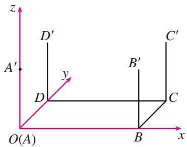
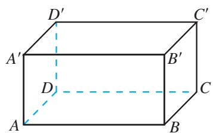
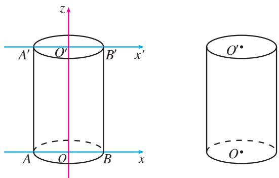
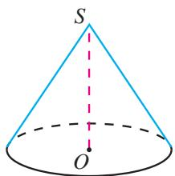
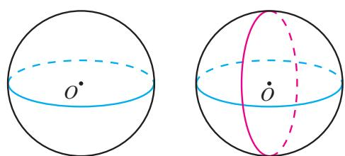
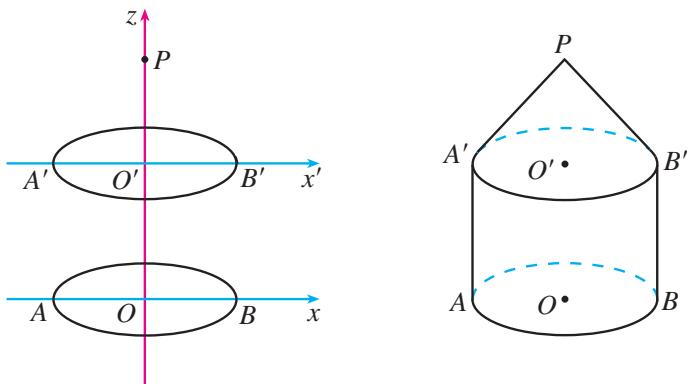

2. 用斜二测画法画出下列水平放置的平面图形的直观图（尺寸自定）.

(3) 正三角形; (4) 正五边形.

画几何体的直观图时，与画平面图形的直观图相比，只是多画一个与 $x$ 轴、 $y$ 轴都垂直的 $z$ 轴，并且使平行于 $z$ 轴的线段的平行性和长度都不变。下面介绍几种简单几何体的直观图的画法。

例 2 已知长方体的长、宽、高分别是 3 cm, 2 cm, 1.5 cm, 用斜二测画法画出它的直观图.

分析：画棱柱的直观图，通常将其底面水平放置。利用斜二测画法画出底面，再画出侧棱，就可以得到棱柱的直观图。长方体是一种特殊的棱柱，为画图简便，可取经过长方体的一个顶点的三条棱所在直线作为 $x$ 轴、 $y$ 轴、 $z$ 轴。

画法：（1）画轴．如图8.2-6，画 $x$ 轴、 $y$ 轴、 $z$ 轴，三轴相交于点 $O(A)$ ，使 $\angle xOy = 45^{\circ}$ ， $\angle xOz = 90^{\circ}$

（2）画底面. 在 $x$ 轴正半轴上取线段 $AB$ ，使 $AB = 3 \mathrm{~cm}$ ；在 $y$ 轴正半轴上取线段 $AD$ ，使 $AD = 1 \mathrm{~cm}$ . 过点 $B$ 作 $y$ 轴的平行线，过点 $D$ 作 $x$ 轴的平行线，设它们的交点为 $C$ ，则 $\square ABCD$ 就是长方体的底面 $ABCD$ 的直观图.

  
图8.2-6

画几何体的直观图时，如果不作严格要求，图形尺寸可以适当选取。用斜二测画法画图的角度也可以自定，但要求图形具有一定的立体感。

（3）画侧棱. 在 $z$ 轴正半轴上取线段 $AA'$ ，使 $AA' = 1.5 \mathrm{~cm}$ ，过 $B$ ， $C$ ， $D$ 各点分别作 $z$ 轴的平行线，在这些平行线上分别截取 $1.5 \mathrm{~cm}$ 长的线段 $BB'$ ， $CC'$ ， $DD'$ .

（4）成图．顺次连接 $A'$ ， $B'$ ， $C'$ ， $D'$ ，并加以整理（去掉辅助线，将被遮挡的部分改为虚线），就得到长方体的直观图了.

例 3 已知圆柱的底面半径为 1 cm，侧面母线长 3 cm，画出它的直观图.

解：（1）画轴．如图8.2-7，画 $x$ 轴、 $z$ 轴，使 $\angle xOz = 90^{\circ}$

  
图8.2-7

（2）画下底面．以 O 为中点，在 x 轴上取线段 AB，使 OA = OB = 1 cm．利用椭圆模板画椭圆，使其经过 A，B 两点．这个椭圆就是圆柱的下底面．

（3）画上底面. 在 $Oz$ 上截取点 $O'$ ，使 $OO' = 3\mathrm{cm}$ ，过点 $O'$ 作平行于轴 $Ox$ 的轴 $O'x'$ . 类似下底面的作法作出圆柱的上底面.

（4）成图．连接 $AA'$ ， $BB'$ ，整理得到圆柱的直观图.

对于圆锥的直观图，一般先画圆锥的底面，再借助于圆锥的轴确定圆锥的顶点，最后画出两侧的两条母线（图8.2-8）.

  
图8.2-8

  
图8.2-9

画球的直观图，一般需要画出球的轮廓线，它是一个圆。同时还经常画出经过球心的截面圆，它们的直观图是椭圆，用以衬托球的立体性（图8.2-9）。

例4 某简单组合体由上下两部分组成，下部是一个圆柱，上部是一个圆锥，圆锥的底面与圆柱的上底面重合．画出这个组合体的直观图.

分析：画组合体的直观图，先要分析它的结构特征，知道其中有哪些简单几何体以及它们的组合方式，然后再画直观图。本题中没有尺寸要求，画图时只需选择合适的大小，表达出该几何体的结构特征就可以了。

画法：如图8.2-10，先画出圆柱的上下底面，再在圆柱和圆锥共同的轴线上确定圆锥的顶点，最后画出圆柱和圆锥的母线，并标注相关字母，就得到组合体的直观图.

  
图8.2-10
