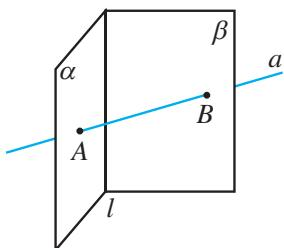
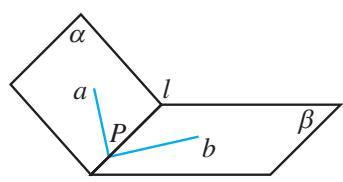

例 1 如图 8.4-16，用符号表示下列图形中直线、平面之间的位置关系.

  
(1)

  
(2)  
图8.4-16

## 相关知识点

- [空间中直线与平面的位置关系（范围关联）](../%E7%9F%A5%E8%AF%86%E7%82%B9/%E7%A9%BA%E9%97%B4%E4%B8%AD%E7%9B%B4%E7%BA%BF%E4%B8%8E%E5%B9%B3%E9%9D%A2%E7%9A%84%E4%BD%8D%E7%BD%AE%E5%85%B3%E7%B3%BB.md)
- [空间中直线与直线的位置关系（范围关联）](../%E7%9F%A5%E8%AF%86%E7%82%B9/%E7%A9%BA%E9%97%B4%E4%B8%AD%E7%9B%B4%E7%BA%BF%E4%B8%8E%E7%9B%B4%E7%BA%BF%E7%9A%84%E4%BD%8D%E7%BD%AE%E5%85%B3%E7%B3%BB.md)
- [空间中平面与平面的位置关系（范围关联）](../%E7%9F%A5%E8%AF%86%E7%82%B9/%E7%A9%BA%E9%97%B4%E4%B8%AD%E5%B9%B3%E9%9D%A2%E4%B8%8E%E5%B9%B3%E9%9D%A2%E7%9A%84%E4%BD%8D%E7%BD%AE%E5%85%B3%E7%B3%BB.md)

> 来源：高中必修 第二册·人教A版数学
