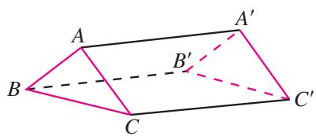

3. 如图， $AA'$ ， $BB'$ ， $CC'$ 不共面，且 $AA' \perp BB'$ ， $BB' \perp CC'$ 。求证： $\triangle ABC \cong \triangle A'B'C'$ 。

  
(第3题)

  
(第4题)

## 相关知识点

- [空间直线的平行关系与等角定理（范围关联）](../%E7%9F%A5%E8%AF%86%E7%82%B9/%E7%A9%BA%E9%97%B4%E7%9B%B4%E7%BA%BF%E7%9A%84%E5%B9%B3%E8%A1%8C%E5%85%B3%E7%B3%BB%E4%B8%8E%E7%AD%89%E8%A7%92%E5%AE%9A%E7%90%86.md)

> 来源：高中必修 第二册·人教A版数学
