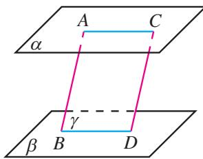

例 5 求证：夹在两个平行平面间的平行线段相等.

如图 8.5-19, $\alpha \parallel \beta$ , AB // CD，且 $A \in \alpha$ , $C \in \alpha$ , $B \in \beta$ , $D \in \beta$ ，求证 AB = CD.

## 题目补充材料（来源原文）

  
图8.5-19

## 相关知识点

- [平面与平面平行的判定及性质（范围关联）](../%E7%9F%A5%E8%AF%86%E7%82%B9/%E5%B9%B3%E9%9D%A2%E4%B8%8E%E5%B9%B3%E9%9D%A2%E5%B9%B3%E8%A1%8C%E7%9A%84%E5%88%A4%E5%AE%9A%E5%8F%8A%E6%80%A7%E8%B4%A8.md)

> 来源：高中必修 第二册·人教A版数学
