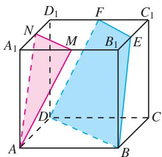
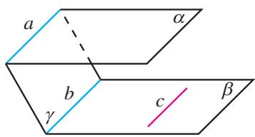

3. 如图，在正方体 $ABCD - A_{1}B_{1}C_{1}D_{1}$ 中， $M, N, E, F$ 分别是棱 $A_{1}B_{1}, A_{1}D_{1}, B_{1}C_{1}, C_{1}D_{1}$ 的中点。求证：平面 $AMN \parallel$ 平面 $DBEF$ .

  
(第3题)

  
(第4题)

## 相关知识点

- [平面与平面平行的判定及性质（范围关联）](../%E7%9F%A5%E8%AF%86%E7%82%B9/%E5%B9%B3%E9%9D%A2%E4%B8%8E%E5%B9%B3%E9%9D%A2%E5%B9%B3%E8%A1%8C%E7%9A%84%E5%88%A4%E5%AE%9A%E5%8F%8A%E6%80%A7%E8%B4%A8.md)

> 来源：高中必修 第二册·人教A版数学
