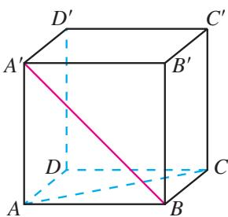

例 1 如图 8.6-3，已知正方体 $ABCD-A'B'C'D'$ .

(1) 哪些棱所在的直线与直线 $AA'$ 垂直?

(2) 求直线 $BA'$ 与 $CC'$ 所成的角的大小.

(3) 求直线 $BA'$ 与 AC 所成的角的大小.

## 相关知识点

- [空间直线垂直与异面直线所成角（范围关联）](../%E7%9F%A5%E8%AF%86%E7%82%B9/%E7%A9%BA%E9%97%B4%E7%9B%B4%E7%BA%BF%E5%9E%82%E7%9B%B4%E4%B8%8E%E5%BC%82%E9%9D%A2%E7%9B%B4%E7%BA%BF%E6%89%80%E6%88%90%E8%A7%92.md)

> 来源：高中必修 第二册·人教A版数学
