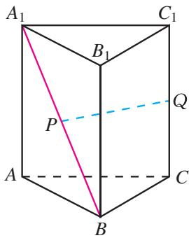

3. 判断下列命题是否正确，正确的说明理由，错误的举例说明.

(1) 一条直线平行于一个平面，另一条直线与这个平面垂直，则这两条直线互相垂直；

（2）如果平面 $\alpha //$ 平面 $\alpha_{1}$ ，平面 $\beta //$ 平面 $\beta_{1}$ ，那么平面 $\alpha$ 与平面 $\beta$ 所成的二面角和平面 $\alpha_{1}$ 与平面 $\beta_{1}$ 所成的二面角相等或互补；

（3）如果平面 $\alpha \perp$ 平面 $\beta$ ，平面 $\beta \perp$ 平面 $\gamma$ ，那么平面 $\alpha \perp$ 平面 $\gamma$

