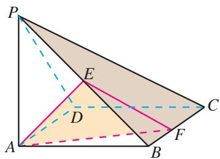

21. 如图，在四棱锥 $P - ABCD$ 中，底面 $ABCD$ 为正方形， $PA \perp$ 底面 $ABCD$ ， $PA = AB$ ， $E$ 为线段 $PB$ 的中点， $F$ 为线段 $BC$ 上的动点。平面 $AEF$ 与平面 $PBC$ 是否互相垂直？如果垂直，请证明；如果不垂直，请说明理由。

  
(第21题)

## 相关知识点

暂无已审核的相关知识点。

> 来源：高中必修 第二册·人教A版数学
