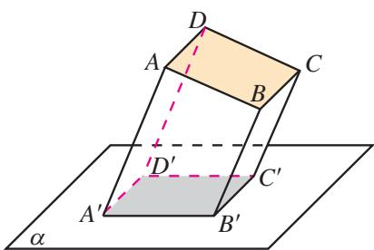
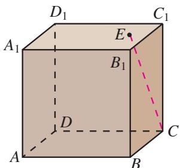

7. 如图，四边形 $A'B'C'D'$ 是 $\square ABCD$ 在平面 $\alpha$ 上的投影（ $AA' \parallel BB' \parallel CC' \parallel DD'$ ），求证：四边形 $A'B'C'D'$ 是平行四边形.

  
(第7题)

  
(第8题)

## 相关知识点

暂无已审核的相关知识点。

> 来源：高中必修 第二册·人教A版数学
