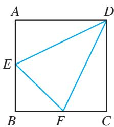
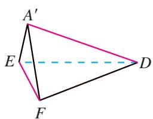

10. 如图，在边长为 2 的正方形 ABCD 中，点 E 是 AB 的中点，点 F 是 BC 的中点，将 $\triangle AED$ ， $\triangle BEF$ ， $\triangle DCF$ 分别沿 DE，EF，DF 折起，使 A，B，C 三点重合于点 $A'$ .

(1) 求证 $A^{\prime}D \perp EF$ ;

(2) 求三棱锥 $A^{\prime}-EFD$ 的体积.

  
(第10题)
