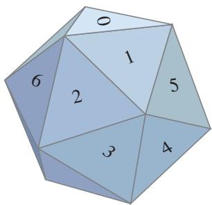

2. 如图，由均匀材质制成的一个正二十面体（每个面都是正三角形），将 20 个面平分成 10 组，第 1 组标上 0，第 2 组标上 1，…，第 10 组标上 9.

（1）投掷正二十面体，若把朝上一面的数字作为投掷结果，则出现0，1，2，…，9是等可能的吗？

(2) 三个正二十面体分别涂上红、黄、蓝三种颜色，分别代表百位、十位、个位，同时投掷可以产生一个三位数（百位为0的也看作三位

  
(第2题)

数)，它是 $000\sim 999$ 范围内的随机数吗？
