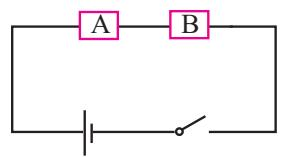
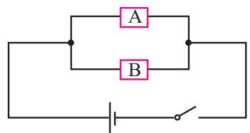

2. 如图，由 A, B 两个元件分别组成串联电路（图（1））和并联电路（图（2）），观察两个元件正常或失效的情况.

（1）写出试验的样本空间；

（2）对串联电路，写出事件 M=“电路是通路”包含的样本点；

（3）对并联电路，写出事件 N=“电路是断路”包含的样本点.

  
(1)

  
(第2题)  
(2)

## 相关知识点

- [有限样本空间与随机事件（范围关联）](../%E7%9F%A5%E8%AF%86%E7%82%B9/%E6%9C%89%E9%99%90%E6%A0%B7%E6%9C%AC%E7%A9%BA%E9%97%B4%E4%B8%8E%E9%9A%8F%E6%9C%BA%E4%BA%8B%E4%BB%B6.md)

> 来源：高中必修 第二册·人教A版数学
