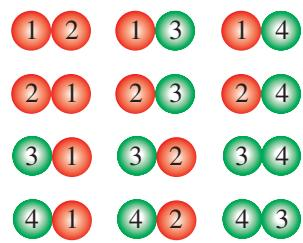

例 6 一个袋子中有大小和质地相同的 4 个球，其中有 2 个红色球（标号为 1 和 2），2 个绿色球（标号为 3 和 4），从袋中不放回地依次随机摸出 2 个球。设事件 $R_{1} =$ “第一次摸到红球”， $R_{2} =$ “第二次摸到红球”，R = “两次都摸到红球”，G = “两次都摸到绿球”，M = “两个球颜色相同”，N = “两个球颜色不同”。

（1）用集合的形式分别写出试验的样本空间以及上述各事件；

(2) 事件 R 与 $R_{1}$ ，R 与 G，M 与 N 之间各有什么关系？

（3）事件 $R$ 与事件 $G$ 的并事件与事件 $M$ 有什么关系？事件 $R_{1}$ 与事件 $R_{2}$ 的交事件与事件 $R$ 有什么关系？

## 相关知识点

- [随机事件的关系与运算（范围关联）](../%E7%9F%A5%E8%AF%86%E7%82%B9/%E9%9A%8F%E6%9C%BA%E4%BA%8B%E4%BB%B6%E7%9A%84%E5%85%B3%E7%B3%BB%E4%B8%8E%E8%BF%90%E7%AE%97.md)

> 来源：高中必修 第二册·人教A版数学
