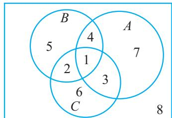

15. 如图是某班级 50 名学生订阅数学、语文、英语学习资料的情况，其中 A 表示订阅数学学习资料的学生，B 表示订阅语文学习资料的学生，C 表示订阅英语学习资料的学生.

（1）从这个班任意选择一名学生，用自然语言描述1，4，5，8各区域所代表的事件；

(2) 用 A, B, C 表示下列事件:

① 至少订阅一种学习资料；

② 恰好订阅一种学习资料；

③ 没有订阅任何学习资料.

  
(第15题)
