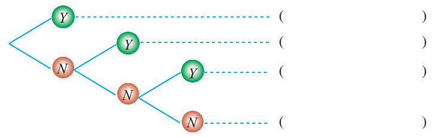

8. 某高校的入学面试中有 3 道难度相当的题目，李明答对每道题目的概率都是 0.6. 若每位面试者共有三次机会，一旦某次答对抽到的题目，则面试通过，否则就一直抽题到第 3 次为止。用 Y 表示答对题目，用 N 表示没有答对题目，假设对抽到的不同题目能否答对是独立的。

第一次 第二次 第三次 样本点

Y ( )

Y ( )

N ( )

（1）在右侧的树状图中填写样本点，并写出样本空间；

（2）求李明第二次答题通过面试的概率；

（3）求李明最终通过面试的概率.

## 相关知识点

暂无已审核的相关知识点。

> 来源：高中必修 第二册·人教A版数学
