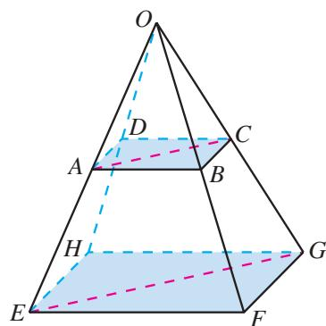

例 1 如图 1.1-9，已知平行四边形 ABCD，过平面 AC 外一点 O 作射线 OA，OB，OC，OD，在四条射线上分别取点 E，F，G，H，使 $\frac{OE}{OA} = \frac{OF}{OB} = \frac{OG}{OC} = \frac{OH}{OD} = k$ 。求证：E，F，G，H 四点共面。

## 相关知识点

- [空间向量的概念与线性运算（范围关联）](../%E7%9F%A5%E8%AF%86%E7%82%B9/%E7%A9%BA%E9%97%B4%E5%90%91%E9%87%8F%E7%9A%84%E6%A6%82%E5%BF%B5%E4%B8%8E%E7%BA%BF%E6%80%A7%E8%BF%90%E7%AE%97.md)

> 来源：高中选择性必修 第一册·人教A版数学
