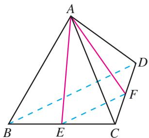
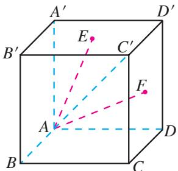

5. 如图，已知正方体 $ABCD - A'B'C'D'$ ， $E$ ， $F$ 分别是上底面 $A'C'$ 和侧面 $CD'$ 的中心。求下列各式中 $x$ ， $y$ 的值：

(1) $\overrightarrow{AC'} = x(\overrightarrow{AB} +\overrightarrow{BC} +\overrightarrow{CC'})$ ；(2) $\overrightarrow{AE} = \overrightarrow{AA'} +x\overrightarrow{AB} +y\overrightarrow{AD}$ ；(3) $\overrightarrow{AF} = \overrightarrow{AD} +x\overrightarrow{AB} +y\overrightarrow{AA'}$

  
(第4题)

  
(第 5 题)
