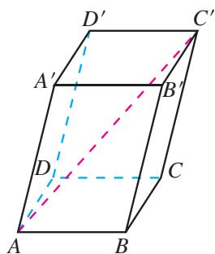

例 2 如图 1.1-12，在平行六面体 ABCD-A'B'C'D' 中，AB = 5，AD = 3，AA' = 7， $\angle BAD = 60^{\circ}$ ， $\angle BAA' = \angle DAA' = 45^{\circ}$ 。求：

(1) $\overrightarrow{AB} \cdot \overrightarrow{AD}$ ; (2) $AC'$ 的长（精确到 0.1）.

## 题目补充材料（来源原文）

  
图1.1-12

## 相关知识点

- [空间向量的数量积运算（范围关联）](../%E7%9F%A5%E8%AF%86%E7%82%B9/%E7%A9%BA%E9%97%B4%E5%90%91%E9%87%8F%E7%9A%84%E6%95%B0%E9%87%8F%E7%A7%AF%E8%BF%90%E7%AE%97.md)

> 来源：高中选择性必修 第一册·人教A版数学
