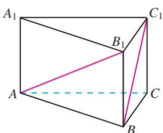

2. 如图，正方体 $ABCD-A'B'C'D'$ 的棱长为 1，设 $\overrightarrow{AB}=a,\quad\overrightarrow{AD}=b,$ $\overrightarrow{AA'}=c$ ，求：

  
(第1题)

(1) $a \cdot (b + c)$ ; (2) $a \cdot (a + b + c)$ ; (3) $(a + b) \cdot (b + c)$ .
