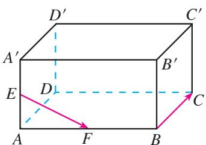
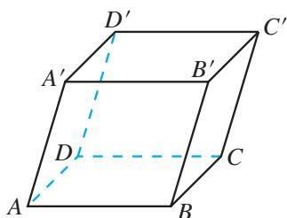

1. 如图，在长方体 $ABCD - A'B'C'D'$ 中， $E$ ， $F$ 分别为棱 $AA'$ ， $AB$ 的中点.

(1) 写出与向量 $\overrightarrow{BC}$ 相等的向量；

(2) 写出与向量 $\overrightarrow{BC}$ 相反的向量；

(3) 写出与向量 $\overrightarrow{EF}$ 平行的向量.

  
(第1题)

  
(第2题)
