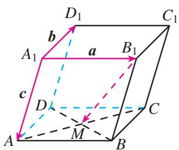
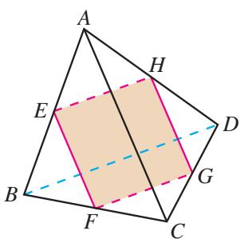
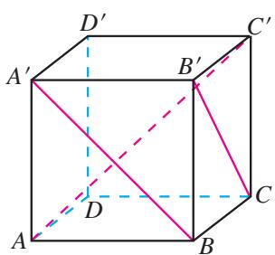

5. 如图，在平行六面体 $ABCD-A_{1}B_{1}C_{1}D_{1}$ 中，AC 与 BD 的交点为 M．设 $\overrightarrow{A_{1}B_{1}}=a,\quad\overrightarrow{A_{1}D_{1}}=b,\quad\overrightarrow{A_{1}A}=c$ ，则下列向量中与 $\overrightarrow{B_{1}M}$ 相等的向量是（）.
(A) $-\frac{1}{2}a+\frac{1}{2}b+c$ (B) $\frac{1}{2}a+\frac{1}{2}b+c$ (C) $\frac{1}{2}a-\frac{1}{2}b+c$ (D) $-\frac{1}{2}a-\frac{1}{2}b+c$

  
(第 5 题)

  
(第6题)

  
(第7题)
