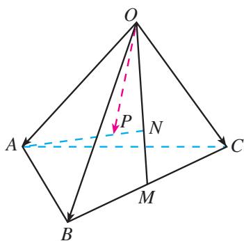

例 1 如图 1.2-2, M 是四面体 OABC 的棱 BC 的中点, 点 N 在线段 OM 上, 点 P 在线段 AN 上, 且 $MN = \frac{1}{2} ON$ , $AP = \frac{3}{4} AN$ , 用向量 $\overrightarrow{OA}$ , $\overrightarrow{OB}$ , $\overrightarrow{OC}$ 表示 $\overrightarrow{OP}$ .

## 题目补充材料（来源原文）

  
图1.2-2

## 相关知识点

- [空间向量基本定理及其证明（范围关联）](../%E7%9F%A5%E8%AF%86%E7%82%B9/%E7%A9%BA%E9%97%B4%E5%90%91%E9%87%8F%E5%9F%BA%E6%9C%AC%E5%AE%9A%E7%90%86%E5%8F%8A%E5%85%B6%E8%AF%81%E6%98%8E.md)

> 来源：高中选择性必修 第一册·人教A版数学
