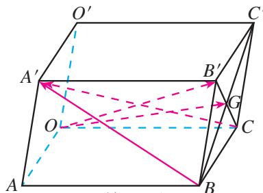
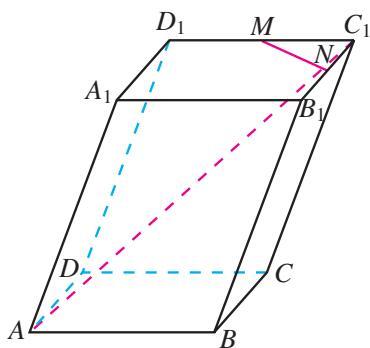
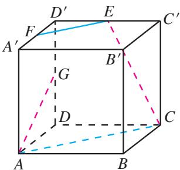

3. 如图，已知平行六面体 $OABC-O'A'B'C'$ ，点 $G$ 是侧面 $BB'C'C$ 的中心，且 $\overrightarrow{OA} = a, \overrightarrow{OC} = b, \overrightarrow{OO'} = c$ .

(1) $\{a, b, c\}$ 是否构成空间的一个基底?

（2）如果 $\{a, b, c\}$ 构成空间的一个基底，那么用它表示下列向量： $\overrightarrow{OB'}$ ， $\overrightarrow{BA'}$ ， $\overrightarrow{CA'}$ ， $\overrightarrow{OG'}$ 。

例 2 如图 1.2-3，在平行六面体 ABCD-A₁B₁C₁D₁ 中，AB=4，AD=4，AA₁=5，∠DAB=60°，∠BAA₁=60°，∠DAA₁=60°，M，N 分别为 D₁C₁，C₁B₁ 的中点。求证 MN⊥AC₁。

分析：要证 $MN \perp AC_1$ ，只需证明 $\overrightarrow{MN} \cdot \overrightarrow{AC_1} = 0$ 。由已知， $\{\overrightarrow{AB}, \overrightarrow{AD}, \overrightarrow{AA_1}\}$ 可构成空间的一个基底。把 $\overrightarrow{MN}$ 和 $\overrightarrow{AC_1}$ 分别用基底表示，然后计算 $\overrightarrow{MN} \cdot \overrightarrow{AC_1}$ 即可。

图1.2-3

证明：设 $\overrightarrow{AB} = a$ ， $\overrightarrow{AD} = b$ ， $\overrightarrow{AA_1} = c$ ，这三个向量不共面， $\{a,b,c\}$ 构成空间的一个基底，我们用它们表示 $\overrightarrow{MN},\overrightarrow{AC_1}$ ，则

$$
\begin{array}{l} \overrightarrow {M N} = \overrightarrow {M C _ {1}} + \overrightarrow {C _ {1} N} = \frac {1}{2} a - \frac {1}{2} b, \\ \overrightarrow {A C _ {1}} = \overrightarrow {A B} + \overrightarrow {B C} + \overrightarrow {C C _ {1}} = a + b + c, \end{array}
$$

所以

$$
\begin{array}{r l} {\overrightarrow {M N} \cdot \overrightarrow {A C _ {1}} = \left(\frac {1}{2} a - \frac {1}{2} b\right) \cdot (a + b + c)} \\ & {= \frac {1}{2} a \cdot a + \frac {1}{2} a \cdot b + \frac {1}{2} a \cdot c - \frac {1}{2} b \cdot a - \frac {1}{2} b \cdot b - \frac {1}{2} b \cdot c} \\ & {= \frac {1}{2} \times 4 ^ {2} + \frac {1}{2} \times 4 ^ {2} \times \cos 6 0 ^ {\circ} + \frac {1}{2} \times 4 \times 5 \times \cos 6 0 ^ {\circ} - \frac {1}{2} \times 4 ^ {2} \times \cos 6 0 ^ {\circ} -} \\ & {\quad \frac {1}{2} \times 4 ^ {2} - \frac {1}{2} \times 4 \times 5 \times \cos 6 0 ^ {\circ}} \\ & {= 0.} \\ {\text {所以} M N \perp A C _ {1}.} \end{array}
$$

例 3 如图 1.2-4，正方体 ABCD-A'B'C'D' 的棱长为 1, E, F, G 分别为 C'D', A'D', D'D 的中点.

(1) 求证: $EF \parallel AC$ ;

(2) 求 CE 与 AG 所成角的余弦值.

分析：（1）要证明 $EF \parallel AC$ ，只需证明 $\overrightarrow{EF}$ 与 $\overrightarrow{AC}$ 共线。设 $\overrightarrow{DA} = i$ ， $\overrightarrow{DC} = j$ ， $\overrightarrow{DD'} = k$ ，则 $\{i, j, k\}$ 构成空间的一个单位正交基底，把 $\overrightarrow{EF}$ 和 $\overrightarrow{AC}$ 分别用基向量表示，作相应的运算证明它们共线即可。（2）要求 $CE$ 与 $AG$ 所成角的余弦值，只需求 $\overrightarrow{CE}$ ， $\overrightarrow{AG}$ 所成角的余弦值即可。

图1.2-4

（1）证明：设 $\overrightarrow{DA} = i$ ， $\overrightarrow{DC} = j$ ， $\overrightarrow{DD'} = k$ ，则 $\{i,j,k\}$ 构成空间的一个单位正交基底．所以

$$
\overrightarrow {E F} = \overrightarrow {D ^ {\prime} F} - \overrightarrow {D ^ {\prime} E} = \frac {1}{2} i - \frac {1}{2} j = \frac {1}{2} (i - j),
$$

$$
\overrightarrow {C A} = \overrightarrow {D A} - \overrightarrow {D C} = i - j.
$$

所以 $\overrightarrow{EF} = \frac{1}{2}\overrightarrow{CA}$

所以 $EF \parallel AC$ .

(2) 解：因为

$$
\overrightarrow {C E} = \overrightarrow {C C ^ {\prime}} + \overrightarrow {C ^ {\prime} E} = - \frac {1}{2} j + k,
$$

$$
\overrightarrow {A G} = \overrightarrow {A D} + \overrightarrow {D G} = - i + \frac {1}{2} k,
$$

所以

$$
\begin{array}{r l} \cos \langle \overrightarrow {C E}, \overrightarrow {A G} \rangle & = \frac {\overrightarrow {C E} \cdot \overrightarrow {A G}}{| \overrightarrow {C E} | | \overrightarrow {A G} |} = \frac {\left(- \frac {1}{2} j + k\right) \cdot \left(- i + \frac {1}{2} k\right)}{\frac {\sqrt {5}}{2} \times \frac {\sqrt {5}}{2}} \\ & = \frac {2}{5}. \end{array}
$$

所以 $CE$ 与 $AG$ 所成角的余弦值为 $\frac{2}{5}$ .

## 相关知识点

- [空间向量基本定理及其证明（范围关联）](../%E7%9F%A5%E8%AF%86%E7%82%B9/%E7%A9%BA%E9%97%B4%E5%90%91%E9%87%8F%E5%9F%BA%E6%9C%AC%E5%AE%9A%E7%90%86%E5%8F%8A%E5%85%B6%E8%AF%81%E6%98%8E.md)

> 来源：高中选择性必修 第一册·人教A版数学
