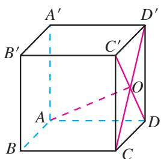

2. 如图，在平行六面体 $ABCD - A'B'C'D'$ 中， $AB = 2$ ， $AD = 2$ ， $AA' = 3$ ， $\angle BAD = \angle BAA' = \angle DAA' = 60^\circ$ 。求 $BC'$ 与 $CA'$ 所成角的余弦值。

  
(第2题)

  
(第3题)

## 相关知识点

- [空间向量基本定理及其证明（范围关联）](../%E7%9F%A5%E8%AF%86%E7%82%B9/%E7%A9%BA%E9%97%B4%E5%90%91%E9%87%8F%E5%9F%BA%E6%9C%AC%E5%AE%9A%E7%90%86%E5%8F%8A%E5%85%B6%E8%AF%81%E6%98%8E.md)

> 来源：高中选择性必修 第一册·人教A版数学
