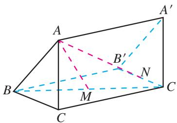

3. 已知四面体 OABC, M, N 分别是棱 OA, BC 的中点，且 $\overrightarrow{OA} = a, \overrightarrow{OB} = b, \overrightarrow{OC} = c$ ，用 a, b, c 表示向量 $\overrightarrow{MN}$ .

## 相关知识点

- [空间向量基本定理及其证明（范围关联）](../%E7%9F%A5%E8%AF%86%E7%82%B9/%E7%A9%BA%E9%97%B4%E5%90%91%E9%87%8F%E5%9F%BA%E6%9C%AC%E5%AE%9A%E7%90%86%E5%8F%8A%E5%85%B6%E8%AF%81%E6%98%8E.md)

> 来源：高中选择性必修 第一册·人教A版数学
