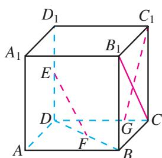

7. 如图，在棱长为 1 的正方体 $ABCD - A_{1}B_{1}C_{1}D_{1}$ 中， $E$ ， $F$ 分别为 $DD_{1}$ ， $BD$ 的中点，点 $G$ 在 $CD$ 上，且 $CG = \frac{1}{4} CD$ .

(1) 求证: $EF \perp B_{1}C;$

(2) 求 EF 与 $C_{1}G$ 所成角的余弦值.

## 相关知识点

- [空间向量基本定理及其证明（范围关联）](../%E7%9F%A5%E8%AF%86%E7%82%B9/%E7%A9%BA%E9%97%B4%E5%90%91%E9%87%8F%E5%9F%BA%E6%9C%AC%E5%AE%9A%E7%90%86%E5%8F%8A%E5%85%B6%E8%AF%81%E6%98%8E.md)

> 来源：高中选择性必修 第一册·人教A版数学
