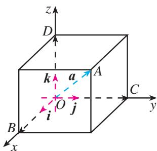

例 1 如图 1.3-6，在长方体 OABC-D'A'B'C' 中，OA=3，OC=4， $OD'=2$ ，以 $\left\{\frac{1}{3}\overrightarrow{OA},\frac{1}{4}\overrightarrow{OC},\frac{1}{2}\overrightarrow{OD'}\right\}$ 为单位正交基底，建立如图所示的空间直角坐标系 Oxyz.

  
图1.3-5

(1) 写出 $D'$ , C, $A'$ , $B'$ 四点的坐标;

(2) 写出向量 $\overrightarrow{A'B'}$ , $\overrightarrow{B'B}$ , $\overrightarrow{A'C'}$ , $\overrightarrow{AC'}$ 的坐标.

