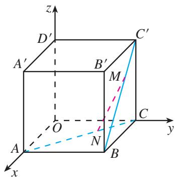
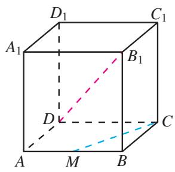

4. 如图，正方体 $OABC - D'A'B'C'$ 的棱长为 $a$ ，点 $N$ ， $M$ 分别在 $AC$ ， $BC'$ 上， $AN = 2CN$ ， $BM = 2MC'$ ，求 $MN$ 的长.

  
(第4题)

  
(第5题)

## 相关知识点

- [空间向量运算的坐标表示（范围关联）](../%E7%9F%A5%E8%AF%86%E7%82%B9/%E7%A9%BA%E9%97%B4%E5%90%91%E9%87%8F%E8%BF%90%E7%AE%97%E7%9A%84%E5%9D%90%E6%A0%87%E8%A1%A8%E7%A4%BA.md)

> 来源：高中选择性必修 第一册·人教A版数学
