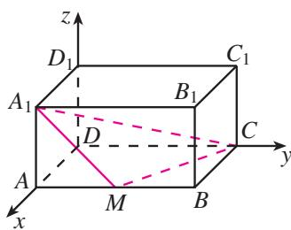

例 1 如图 1.4-7，在长方体 $ABCD-A_{1}B_{1}C_{1}D_{1}$ 中，AB=4，BC=3， $CC_{1}=2$ ，M 是 AB 的中点。以 D 为原点，DA，DC， $DD_{1}$ 所在直线分别为 x 轴、y 轴、z 轴，建立如图所示的空间直角坐标系。

(1) 求平面 $BCC_{1}B_{1}$ 的法向量；

(2) 求平面 $MCA_{1}$ 的法向量.

图1.4-7

