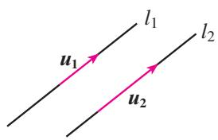
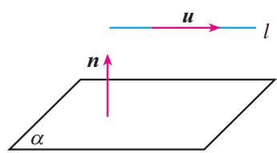
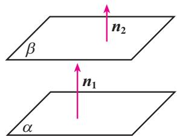
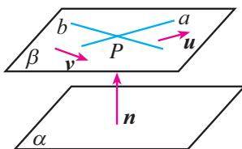
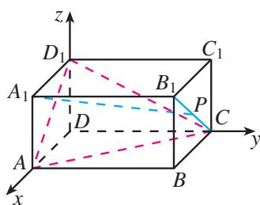

3. 在长方体 $ABCD - A_{1}B_{1}C_{1}D_{1}$ 中， $AB = 4$ ， $BC = 3$ ， $CC_{1} = 2$ 。以 $D$ 为原点，以 $\left\{\frac{1}{3}\overrightarrow{DA}, \frac{1}{4}\overrightarrow{DC}, \frac{1}{2}\overrightarrow{DD_{1}}\right\}$ 为空间的一个单位正交基底，建立空间直角坐标系 $Oxyz$ ，求平面 $ACD_{1}$ 的一个法向量。

我们知道，直线的方向向量和平面的法向量是确定空间中的直线和平面的关键量。那么是否能用这些向量来刻画空间直线、平面的平行、垂直关系呢？首先来看平行的问题。

思考

由直线与直线、直线与平面或平面与平面的平行关系，可以得到直线的方向向量、平面的法向量间的什么关系？

如图1.4-8，设 $\pmb{u}_{1}$ ， $\pmb{u}_{2}$ 分别是直线 $l_{1}$ ， $l_{2}$ 的方向向量。由方向向量的定义可知，如果两条直线平行，那么它们的方向向量一定平行；反过来，如果两条直线的方向向量平行，那么这两条直线也平行。所以

$$
l _ {1} / / l _ {2} \Leftrightarrow \boldsymbol {u} _ {1} / / \boldsymbol {u} _ {2} \Leftrightarrow \exists   \lambda \in \mathbf {R}, \text {使得}   \boldsymbol {u} _ {1} = \lambda \boldsymbol {u} _ {2}.
$$

  
图1.4-8

  
图1.4-9

  
图1.4-10

类似地，如图1.4-9，设 $\pmb{u}$ 是直线 $l$ 的方向向量， $\pmb{n}$ 是平面 $\alpha$ 的法向量， $l \not\subset \alpha$ 则

$$
l / / \alpha \Leftrightarrow \boldsymbol {u} \perp \boldsymbol {n} \Leftrightarrow \boldsymbol {u} \cdot \boldsymbol {n} = 0.
$$

如图1.4-10，设 $\pmb{n}_{1}$ ， $\pmb{n}_{2}$ 分别是平面 $\alpha$ ， $\beta$ 的法向量，则

$$
\alpha / / \beta \Longleftrightarrow \pmb {n} _ {1} / / \pmb {n} _ {2} \Longleftrightarrow \exists   \lambda \in \mathbf {R},    \text {使得}   \pmb {n} _ {1} = \lambda \pmb {n} _ {2}.
$$

例 2 证明 “平面与平面平行的判定定理”：若一个平面内的两条相交直线与另一个平面平行，则这两个平面平行.

已知：如图1.4-11， $a\subset \beta$ ， $b\subset \beta$ ， $a\cap b = P$ ， $a / / \alpha$ ， $b / / \alpha$

求证： $\alpha\parallel\beta.$

分析：设平面 $\alpha$ 的法向量为 $n$ ，直线 $a, b$ 的方向向量分别为 $u, v$ ，则由已知条件可得 $n \cdot u = n \cdot v = 0$ ，由此可以证明 $n$ 与平面 $\beta$ 内的任意一个向量垂直，即 $n$ 也是 $\beta$ 的法向量。

  
图1.4-11

证明：如图 1.4-11，取平面 $\alpha$ 的法向量 n，直线 a，b 的方向向量 u，v.

因为 $a / / \alpha$ ， $b / / \alpha$ ，所以 $\pmb {n}\cdot \pmb {u} = 0$ ， $\pmb {n}\cdot \pmb {v} = 0.$

因为 $a \subset \beta, b \subset \beta, a \cap b = P$

所以对任意点 $Q \in \beta$ ，存在 x， $y \in R$ ，使得 $\overrightarrow{PQ} = x u + y v$ .

从而 $n \cdot \overrightarrow{PQ} = n \cdot (xu + yv) = xn \cdot u + yn \cdot v = 0.$

所以，向量 n 也是平面 $\beta$ 的法向量．故 $\alpha //\beta$ .

例 3 如图 1.4-12，在长方体 $ABCD-A_{1}B_{1}C_{1}D_{1}$ 中，AB=4，BC=3， $CC_{1}=2$ 。线段 $B_{1}C$ 上是否存在点 P，使得 $A_{1}P \parallel$ 平面 $ACD_{1}$ ?

分析：根据条件建立适当的空间直角坐标系，那么问题中涉及的点、向量 $\overrightarrow{B_1C}$ ， $\overrightarrow{A_1P}$ ，以及平面 $ACD_1$ 的法向量 $\pmb{n}$ 等都可以用坐标表示。如果点 $P$ 存在，那么就有 $\pmb{n} \cdot \overrightarrow{A_1P} = 0$ ，由此通过向量的坐标运算可得结果。

解：以 D 为原点，DA，DC， $DD_{1}$ 所在直线分别为 x 轴、y 轴、z 轴，建立如图 1.4-12 所示的空间直角坐标系．因为 A，C， $D_{1}$ 的坐标分别为 $(3,0,0)$ ， $(0,4,0)$ ， $(0,0,2)$ ，所以

图1.4-12

$$
\overrightarrow {A C} = (- 3, 4, 0), \overrightarrow {A D _ {1}} = (- 3, 0, 2).
$$

设 $n = (x, y, z)$ 是平面 $ACD_{1}$ 的法向量，则 $n \cdot \overrightarrow{AC} = 0$ ， $n \cdot \overrightarrow{AD_{1}} = 0$ ，即

$$
\left\{ \begin{array}{l} - 3 x + 4 y = 0, \\ - 3 x + 2 z = 0. \end{array} \right.
$$

所以

$$
\left\{ \begin{array}{l} x = \frac {2}{3} z, \\ y = \frac {1}{2} z. \end{array} \right.
$$

取 z=6，则 x=4，y=3。所以， $n=(4,3,6)$ 是平面 $ACD_{1}$ 的一个法向量。

由 $A_{1}, C, B_{1}$ 的坐标分别为 $(3, 0, 2), (0, 4, 0), (3, 4, 2)$ ，得 $\overrightarrow{A_1B_1} = (0, 4, 0), \overrightarrow{B_1C} = (-3, 0, -2)$ 。设点 $P$ 满足 $\overrightarrow{B_1P} = \lambda \overrightarrow{B_1C} (0 \leqslant \lambda \leqslant 1)$ ，则 $\overrightarrow{B_1P} = (-3\lambda, 0, -2\lambda)$ ，所以 $\overrightarrow{A_1P} = \overrightarrow{A_1B_1} + \overrightarrow{B_1P} = (-3\lambda, 4, -2\lambda)$ 。

第一章 空间向量与立体几何

令 $n \cdot \overrightarrow{A_{1}P}=0$ ，得 $-12\lambda+12-12\lambda=0$ ，解得 $\lambda=\frac{1}{2}$ ，此时 $A_{1}P \not\subset$ 平面 $ACD_{1}$ ，这样的点 P 存在。所以，当 $\overrightarrow{B_{1}P}=\frac{1}{2}\overrightarrow{B_{1}C}$ ，即 P 为 $B_{1}C$ 的中点时， $A_{1}P \parallel$ 平面 $ACD_{1}$ 。
