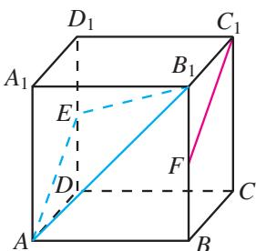
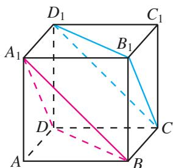

2. 如图，在棱长为1的正方体 $ABCD - A_{1}B_{1}C_{1}D_{1}$ 中， $E$ 为线段 $DD_{1}$ 的中点， $F$ 为线段 $BB_{1}$ 的中点.

(1) 求点 $A_{1}$ 到直线 $B_{1}E$ 的距离；

(2) 求直线 $FC_{1}$ 到直线 AE 的距离；

(3) 求点 $A_{1}$ 到平面 $AB_{1}E$ 的距离；

(4) 求直线 $FC_{1}$ 到平面 $AB_{1}E$ 的距离.

  
(第2题)

  
(第3题)

## 相关知识点

- [空间距离与夹角的向量计算（范围关联）](../%E7%9F%A5%E8%AF%86%E7%82%B9/%E7%A9%BA%E9%97%B4%E8%B7%9D%E7%A6%BB%E4%B8%8E%E5%A4%B9%E8%A7%92%E7%9A%84%E5%90%91%E9%87%8F%E8%AE%A1%E7%AE%97.md)

> 来源：高中选择性必修 第一册·人教A版数学
