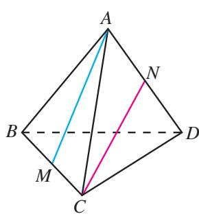
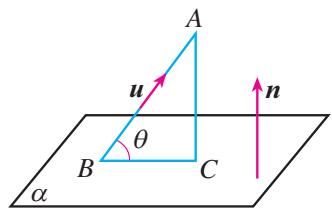
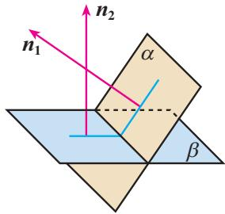
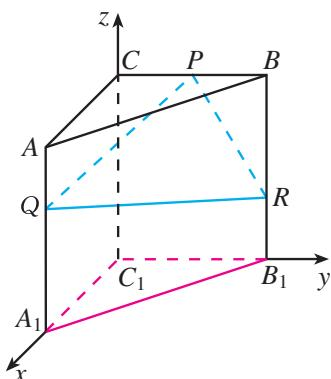

3. 如图，在棱长为1的正方体 $ABCD - A_{1}B_{1}C_{1}D_{1}$ 中，求平面 $A_{1}DB$ 与平面 $D_{1}CB_{1}$ 的距离.

与距离类似，角度是立体几何中另一个重要的度量。下面我们用向量方法研究直线与直线所成的角、直线与平面所成的角以及平面与平面的夹角，先看下列问题。

例7 如图1.4-19，在棱长为1的正四面体（四个面都是正三角形）ABCD中， $M$ ， $N$ 分别为 $BC$ ， $AD$ 的中点，求直线 $AM$ 和 $CN$ 夹角的余弦值.

分析：求直线 $AM$ 和 $CN$ 夹角的余弦值，可以转化为求向量 $\overrightarrow{MA}$ 与 $\overrightarrow{CN}$ 夹角的余弦值．为此需要把向量 $\overrightarrow{MA}$ ， $\overrightarrow{CN}$ 用适当的基底表示出来，进而求得向量 $\overrightarrow{MA}$ ， $\overrightarrow{CN}$ 夹角的余弦值.

解：

图1.4-19

如图1.4-19，以 $\{\overrightarrow{CA},\overrightarrow{CB},\overrightarrow{CD}\}$ 作为基底，则

$$
\overrightarrow {M A} = \overrightarrow {C A} - \overrightarrow {C M} = \overrightarrow {C A} - \frac {1}{2} \overrightarrow {C B}, \quad \overrightarrow {C N} = \frac {1}{2} (\overrightarrow {C A} + \overrightarrow {C D}).
$$

设向量 $\overrightarrow{CN}$ 与 $\overrightarrow{MA}$ 的夹角为 $\theta$ ，则直线 AM 和 CN 夹角的余弦值等于 $|\cos \theta|$ .

$$
\begin{array}{r l} \overrightarrow {C N} \cdot \overrightarrow {M A} & = \frac {1}{2} (\overrightarrow {C A} + \overrightarrow {C D}) \cdot (\overrightarrow {C A} - \frac {1}{2} \overrightarrow {C B}) \\ & = \frac {1}{2} \overrightarrow {C A} ^ {2} - \frac {1}{4} \overrightarrow {C A} \cdot \overrightarrow {C B} + \frac {1}{2} \overrightarrow {C D} \cdot \overrightarrow {C A} - \frac {1}{4} \overrightarrow {C D} \cdot \overrightarrow {C B} \\ & = \frac {1}{2} - \frac {1}{8} + \frac {1}{4} - \frac {1}{8} = \frac {1}{2}. \end{array}
$$

又 $\triangle ABC$ 和 $\triangle ACD$ 均为等边三角形，所以 $|\overrightarrow{MA}|=|\overrightarrow{CN}|=\frac{\sqrt{3}}{2}$ .

所以

$$
\cos \theta = \frac {\overrightarrow {C N} \cdot \overrightarrow {M A}}{| \overrightarrow {C N} | | \overrightarrow {M A} |} = \frac {\frac {1}{2}}{\frac {\sqrt {3}}{2} \times \frac {\sqrt {3}}{2}} = \frac {2}{3}.
$$

所以直线 AM 和 CN 夹角的余弦值为 $\frac{2}{3}$ .

思考

以上我们用向量方法解决了异面直线 $AM$ 和 $CN$ 所成角的问题，你能用向量方法求直线 $AB$ 与平面 $BCD$ 所成的角吗？

一般地，两条异面直线所成的角，可以转化为两条异面直线的方向向量的夹角来求

得．也就是说，若异面直线 $l_{1}$ ， $l_{2}$ 所成的角为 $\theta$ ，其方向向量分别是 u，v，则

$$
\cos \theta = | \cos \langle \boldsymbol {u}, \boldsymbol {v} \rangle | = \left| \frac {\boldsymbol {u} \cdot \boldsymbol {v}}{| \boldsymbol {u} | | \boldsymbol {v} |} \right| = \frac {| \boldsymbol {u} \cdot \boldsymbol {v} |}{| \boldsymbol {u} | | \boldsymbol {v} |}.
$$

类似地，直线与平面所成的角，可以转化为直线的方向向量与平面的法向量的夹角。如图1.4-20，直线 $AB$ 与平面 $\alpha$ 相交于点 $B$ ，设直线 $AB$ 与平面 $\alpha$ 所成的角为 $\theta$ ，直线 $AB$ 的方向向量为 $\pmb{u}$ ，平面 $\alpha$ 的法向量为 $\pmb{n}$ ，则

$$
\sin \theta = | \cos \langle \boldsymbol {u}, \boldsymbol {n} \rangle | = \left| \frac {\boldsymbol {u} \cdot \boldsymbol {n}}{| \boldsymbol {u} | | \boldsymbol {n} |} \right| = \frac {| \boldsymbol {u} \cdot \boldsymbol {n} |}{| \boldsymbol {u} | | \boldsymbol {n} |}.
$$

  
图1.4-20

  
图1.4-21

如图 1.4-21，平面 $\alpha$ 与平面 $\beta$ 相交，形成四个二面角，我们把这四个二面角中不大于 $90^{\circ}$ 的二面角称为平面 $\alpha$ 与平面 $\beta$ 的夹角.

类似于两条异面直线所成的角，若平面 $\alpha$ ， $\beta$ 的法向量分别是 $n_{1}$ 和 $n_{2}$ ，则平面 $\alpha$ 与平面 $\beta$ 的夹角即向量 $n_{1}$ 和 $n_{2}$ 的夹角或其补角。设平面 $\alpha$ 与平面 $\beta$ 的夹角为 $\theta$ ，则

图1.4-21中有几个二面角？两个平面的夹角与这两个平面形成的二面角有什么关系？

$$
\cos \theta = | \cos \langle \boldsymbol {n} _ {1}, \boldsymbol {n} _ {2} \rangle | = \left| \frac {\boldsymbol {n} _ {1} \cdot \boldsymbol {n} _ {2}}{| \boldsymbol {n} _ {1} | | \boldsymbol {n} _ {2} |} \right| = \frac {| \boldsymbol {n} _ {1} \cdot \boldsymbol {n} _ {2} |}{| \boldsymbol {n} _ {1} | | \boldsymbol {n} _ {2} |}.
$$

例 8 如图 1.4-22，在直三棱柱 $ABC-A_{1}B_{1}C_{1}$ 中， $AC=CB=2,\ AA_{1}=3,\ \angle ACB=90^{\circ}, P$ 为 BC 的中点，点 Q，R 分别在棱 $AA_{1}, BB_{1}$ 上， $A_{1}Q=2AQ, BR=2RB_{1}$ . 求平面 PQR 与平面 $A_{1}B_{1}C_{1}$ 夹角的余弦值.

分析：因为平面 $PQR$ 与平面 $A_{1}B_{1}C_{1}$ 的夹角可以转化为平面 $PQR$ 与平面 $A_{1}B_{1}C_{1}$ 的法向量的夹角，所以只需要求出这两个平面的法向量的夹角即可.

解：

化为向量问题

图1.4-22

以 $C_1$ 为原点， $C_1A_1$ ， $C_1B_1$ ， $C_1C$ 所在直线为 $x$ 轴、 $y$ 轴、 $z$ 轴，建立如图1.4-22所示的空间直角坐标系。设平面 $A_1B_1C_1$ 的法向量为 $\pmb{n}_1$ ，平面 $PQR$ 的法向量为 $\pmb{n}_2$ ，则平面 $PQR$ 与平面 $A_1B_1C_1$ 的夹角就是 $\pmb{n}_1$ 与 $\pmb{n}_2$ 的夹角或其补角。

因为 $C_1C \perp$ 平面 $A_1B_1C_1$ ，所以平面 $A_1B_1C_1$ 的一个法向量为 $\boldsymbol{n}_1 = (0, 0, 1)$ .

根据所建立的空间直角坐标系，可知 $P(0,1,3)$ ， $Q(2,0,2)$ ， $R(0,2,1)$ 。所以 $\overrightarrow{PQ} = (2, -1, -1)$ ， $\overrightarrow{PR} = (0, 1, -2)$ 。设 $\pmb{n}_2 = (x, y, z)$ ，则

$$
\left\{ \begin{array}{l} \boldsymbol {n} _ {2} \cdot \overrightarrow {P Q} = 0, \\ \boldsymbol {n} _ {2} \cdot \overrightarrow {P R} = 0, \end{array} \right.
$$

所以

$$
\left\{ \begin{array}{l} 2 x - y - z = 0, \\ y - 2 z = 0. \end{array} \right.
$$

所以

$$
\left\{ \begin{array}{l} x = \frac {3}{2} z, \\ y = 2 z. \end{array} \right.
$$

取 $n_2 = (3, 4, 2)$ ，则

$$
\cos \left\langle \boldsymbol {n} _ {1}, \boldsymbol {n} _ {2} \right\rangle = \frac {\boldsymbol {n} _ {1} \cdot \boldsymbol {n} _ {2}}{\left| \boldsymbol {n} _ {1} \right| \left| \boldsymbol {n} _ {2} \right|} = \frac {(0 , 0 , 1) \cdot (3 , 4 , 2)}{1 \times \sqrt {2 9}} = \frac {2 \sqrt {2 9}}{2 9}.
$$

回到图形问题

设平面 $PQR$ 与平面 $A_{1}B_{1}C_{1}$ 的夹角为 $\theta$ ，则

$$
\cos \theta = | \cos \langle \boldsymbol {n} _ {1}, \boldsymbol {n} _ {2} \rangle | = \frac {2 \sqrt {2 9}}{2 9}.
$$

即平面 PQR 与平面 $A_{1}B_{1}C_{1}$ 的夹角的余弦值为 $\frac{2\sqrt{29}}{29}$ .

## 相关知识点

- [空间距离与夹角的向量计算（范围关联）](../%E7%9F%A5%E8%AF%86%E7%82%B9/%E7%A9%BA%E9%97%B4%E8%B7%9D%E7%A6%BB%E4%B8%8E%E5%A4%B9%E8%A7%92%E7%9A%84%E5%90%91%E9%87%8F%E8%AE%A1%E7%AE%97.md)

> 来源：高中选择性必修 第一册·人教A版数学
