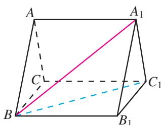

2. $PA, PB, PC$ 是从点 $P$ 出发的三条射线，每两条射线的夹角均为 $60^{\circ}$ ，那么直线 $PC$ 与平面 $PAB$ 所成角的余弦值是（）.
(A) $\frac{1}{2}$ (B) $\frac{\sqrt{2}}{2}$ (C) $\frac{\sqrt{3}}{3}$ (D) $\frac{\sqrt{6}}{3}$

  
(第3题)

## 相关知识点

- [空间距离与夹角的向量计算（范围关联）](../%E7%9F%A5%E8%AF%86%E7%82%B9/%E7%A9%BA%E9%97%B4%E8%B7%9D%E7%A6%BB%E4%B8%8E%E5%A4%B9%E8%A7%92%E7%9A%84%E5%90%91%E9%87%8F%E8%AE%A1%E7%AE%97.md)

> 来源：高中选择性必修 第一册·人教A版数学
