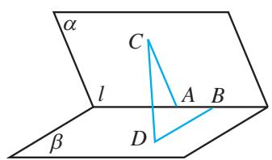
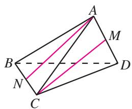
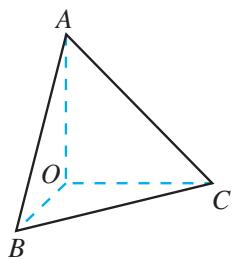

1. 如图，二面角 $\alpha - l - \beta$ 的棱上有两个点 $A, B$ ，线段 $BD$ 与 $AC$ 分别在这个二面角的两个面内，并且都垂直于棱 $l$ 。若 $AB = 4$ ， $AC = 6$ ， $BD = 8$ ， $CD = 2\sqrt{17}$ ，求平面 $\alpha$ 与平面 $\beta$ 的夹角。

  
(第1题)

  
(第2题)

  
(第3题)
