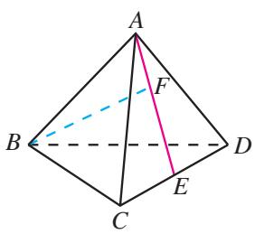
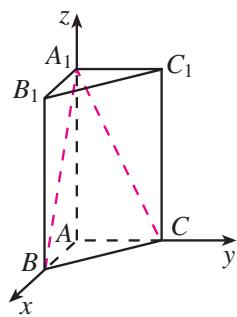

2. 如图，在直三棱柱 $ABC - A_{1}B_{1}C_{1}$ 中， $AB \perp AC$ ， $AB = AC = 1$ ， $AA_{1} = 2$ 。以 $A$ 为原点，建立如图所示空间直角坐标系。

（1）求平面 $BCC_{1}B_{1}$ 的法向量；（2）求平面 $A_{1}BC$ 的法向量.

  
(第1题)

  
(第2题)

## 相关知识点

暂无已审核的相关知识点。

> 来源：高中选择性必修 第一册·人教A版数学
