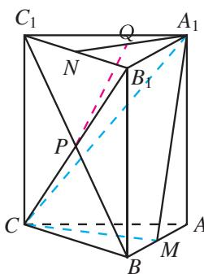

16. 如图，在直三棱柱 $ABC - A_{1}B_{1}C_{1}$ 中， $\angle BAC = 90^{\circ}$ ， $AB = AC = 2$ ， $AA_{1} = 3$ 。 $M$ 是 $AB$ 的中点， $N$ 是 $B_{1}C_{1}$ 的中点， $P$ 是 $BC_{1}$ 与 $B_{1}C$ 的交点。在线段 $A_{1}N$ 上是否存在点 $Q$ ，使得 $PQ // \text{平面 } A_{1}CM?$ 17. 在空间直角坐标系中，已知向量 $\boldsymbol{u} = (a, b, c) (abc \neq 0)$ ，点 $P_{0}(x_{0}, y_{0}, z_{0})$ ，点 $P(x, y, z)$ 。

（1）若直线 $l$ 经过点 $P_{0}$ ，且以 $\boldsymbol{u}$ 为方向向量， $P$ 是直线 $l$ 上的任意一点，求证： $\frac{x - x_{0}}{a} = \frac{y - y_{0}}{b} = \frac{z - z_{0}}{c}$ ；

（2）若平面 $\alpha$ 经过点 $P_{0}$ ，且以 $\boldsymbol{u}$ 为法向量， $P$ 是平面 $\alpha$ 内的任意一点，求证： $a(x - x_{0}) + b(y - y_{0}) + c(z - z_{0}) = 0$ 。

  
(第 16 题)
