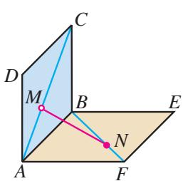

18. 在如图所示的试验装置中，两个正方形框架 $ABCD$ ， $ABEF$ 的边长都是 1，且它们所在的平面互相垂直。活动弹子 $M$ ， $N$ 分别在正方形对角线 $AC$ 和 $BF$ 上移动，且 $CM$ 和 $BN$ 的长度保持相等，记 $CM = BN = a (0 < a < \sqrt{2})$ 。
（1）求 $MN$ 的长；
（2） $a$ 为何值时， $MN$ 的长最小？
（3）当 $MN$ 的长最小时，求平面 $MNA$ 与平面 $MNB$ 夹角的余弦值。

  
(第 18 题)
