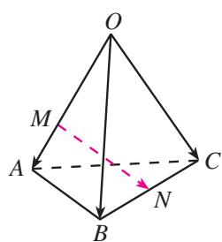
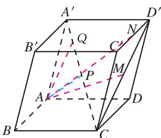

1. 如图，在四面体 OABC 中， $\overrightarrow{OA}=a,\overrightarrow{OB}=b,\overrightarrow{OC}=c$ 。点 M 在 OA 上，且 OM=2MA，N 为 BC 中点，则 $\overrightarrow{MN}$ 等于（）.
(A) $\frac{1}{2}a-\frac{2}{3}b+\frac{1}{2}c$ (B) $-\frac{2}{3}a+\frac{1}{2}b+\frac{1}{2}c$ (C) $\frac{1}{2}a+\frac{1}{2}b-\frac{1}{2}c$ (D) $\frac{2}{3}a+\frac{2}{3}b-\frac{1}{2}c$

  
(第1题)

  
(第2题)
