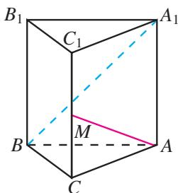
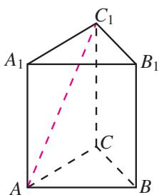

3. 如图，在直三棱柱 $ABC - A_{1}B_{1}C_{1}$ 中， $\angle ABC = 90^{\circ}$ ， $CB = 1$ ， $CA = 2$ ， $AA_{1} = \sqrt{6}$ ， $M$ 是 $CC_{1}$ 的中点。求证： $AM \perp BA_{1}$ 。

  
(第3题)

  
(第4题)

## 相关知识点

暂无已审核的相关知识点。

> 来源：高中选择性必修 第一册·人教A版数学
