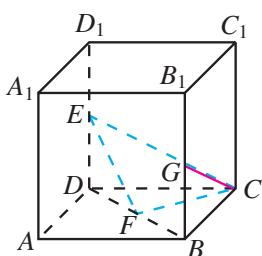

8. 如图，在棱长为 1 的正方体 $ABCD - A_{1}B_{1}C_{1}D_{1}$ 中， $E, F, G$ 分别是 $DD_{1}, BD, BB_{1}$ 的中点.

(1) 求证: $EF \perp CF$ ;

(2) 求 EF 与 CG 所成角的余弦值;

(3) 求 CE 的长.

  
(第8题)

  
(第9题)

## 相关知识点

暂无已审核的相关知识点。

> 来源：高中选择性必修 第一册·人教A版数学
