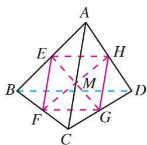

15. 如图，在四面体 $ABCD$ 中， $E, F, G, H$ 分别是 $AB, BC, CD, DA$ 的中点.

（1）求证： $E$ ， $F$ ， $G$ ， $H$ 四点共面；

(2) 求证: $BD \parallel$ 平面 $EFGH$ ;

(3) 设 M 是 EG 和 FH 的交点，求证：对空间任意一点 O，

$$
\text {有} \overrightarrow {O M} = \frac {1}{4} (\overrightarrow {O A} + \overrightarrow {O B} + \overrightarrow {O C} + \overrightarrow {O D}).
$$

(第 15 题)  

