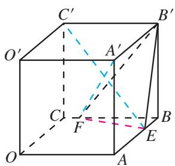
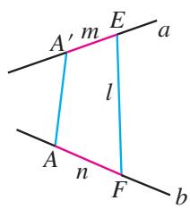

16. 如图，在棱长为 $a$ 的正方体 $OABC - O'A'B'C'$ 中， $E$ ， $F$ 分别是棱 $AB$ ， $BC$ 上的动点，且 $AE = BF$ .

(1) 求证: $A^{\prime}F \perp C^{\prime}E$ ;

（2）当三棱锥 $B^{\prime} - BEF$ 的体积取得最大值时，求平面 $B^{\prime}EF$ 与平面 $BEF$ 的夹角正切值.

  
(第 16 题)

  
(第 17 题)
