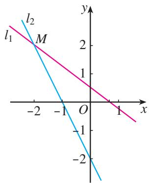

例2 判断下列各对直线的位置关系．如果相交，求出交点的坐标：

(1) $l_{1}: x - y = 0, \quad l_{2}: 3x + 3y - 10 = 0;$

图2.3-1

(2) $l_{1}: 3x - y + 4 = 0, \quad l_{2}: 6x - 2y - 1 = 0;$

(3) $l_{1}: 3x + 4y - 5 = 0, \quad l_{2}: 6x + 8y - 10 = 0.$

