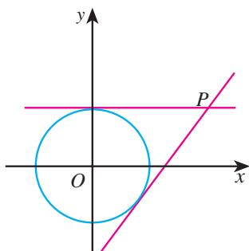

例 2 过点 $P(2,1)$ 作圆 O: $x^{2}+y^{2}=1$ 的切线 l，求切线 l 的方程.

分析：如图2.5-2，容易知道，点 $P(2,1)$ 位于圆 $O: x^{2} + y^{2} = 1$ 外，经过圆外一点有两条直线与这个圆相切。我们设切线方程为 $y - 1 = k(x - 2)$ ， $k$ 为斜率。由直线与圆相切可求出 $k$ 的值。

  
图2.5-2

