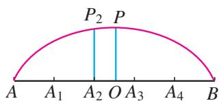
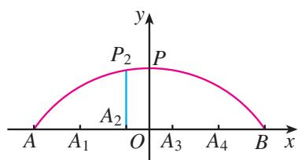
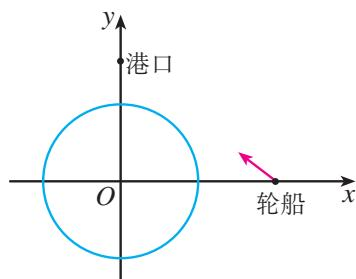

3. 判断直线 $2x - y + 2 = 0$ 与圆 $(x - 1)^2 + (y - 2)^2 = 4$ 的位置关系；如果相交，求直线被圆截得的弦长.

例 3 图 2.5-3 是某圆拱形桥一孔圆拱的示意图．圆拱跨度 AB=20 m，拱高 OP=4 m，建造时每间隔 4 m 需要用一根支柱支撑，求支柱 $A_{2}P_{2}$ 的高度（精确到 0.01 m）.

  
图2.5-3

  
图2.5-4

分析：建立如图2.5-4所示的直角坐标系，要得到支柱 $A_{2}P_{2}$ 的高度，只需求出点 $P_{2}$ 的纵坐标.

解：建立如图 2.5-4 所示的直角坐标系，使线段 AB 所在直线为 x 轴，O 为坐标原点，圆心在 y 轴上．由题意，点 P，B 的坐标分别为 $(0, 4)$ ， $(10, 0)$ ．设圆心坐标是 $(0, b)$ ，圆的半径是 r，那么圆的方程是

$$
x ^ {2} + (y - b) ^ {2} = r ^ {2}.
$$

点 $O$ 是圆拱所在圆的圆心吗？

下面确定 b 和 r 的值.

因为 P, B 两点都在圆上，所以它们的坐标 $(0, 4)$ ， $(10, 0)$ 都满足方程 $x^{2} + (y - b)^{2} = r^{2}$ 。于是，得到方程组

$$
\left\{ \begin{array}{l} 0 ^ {2} + (4 - b) ^ {2} = r ^ {2}, \\ 1 0 ^ {2} + (0 - b) ^ {2} = r ^ {2}. \end{array} \right.
$$

解得

$$
b = - 1 0. 5, r ^ {2} = 1 4. 5 ^ {2}.
$$

所以，圆的方程是

$$
x ^ {2} + (y + 1 0. 5) ^ {2} = 1 4. 5 ^ {2}.
$$

把点 $P_{2}$ 的横坐标 $x = -2$ 代入圆的方程，得

$$
(- 2) ^ {2} + (y + 1 0. 5) ^ {2} = 1 4. 5 ^ {2},
$$

即 $y + 10.5 = \sqrt{14.5^2 - (-2)^2}$ （ $P_2$ 的纵坐标 $y > 0$ ，平方根取正值）。所以

$$
y = \sqrt {1 4 . 5 ^ {2} - (- 2) ^ {2}} - 1 0. 5 \approx 1 4. 3 6 - 1 0. 5 = 3. 8 6 (\mathrm{m}).
$$

答：支柱 $A_{2}P_{2}$ 的高度约为 3.86 m.

思考

如果不建立平面直角坐标系，你能解决这个问题吗？由此比较综合法和坐标法的特点.

例4一个小岛的周围有环岛暗礁，暗礁分布在以小岛中心为圆心，半径为 $20\mathrm{km}$ 的圆形区域内．已知小岛中心位于轮船正西 $40~\mathrm{km}$ 处，港口位于小岛中心正北 $30~\mathrm{km}$ 处．如

果轮船沿直线返港，那么它是否会有触礁危险？

分析：先画出示意图，了解小岛中心、轮船、港口的方位和距离。如图2.5-5，根据题意，建立适当的平面直角坐标系，求出暗礁所在区域的边缘圆的方程，以及轮船返港直线的方程，利用方程判断直线与圆的位置关系，进而确定轮船是否有触礁危险。

  
图2.5-5

解：以小岛的中心为原点 $O$ ，东西方向为 $x$ 轴，建立如图 2.5-5 所示的直角坐标系．为了运算的简便，我们取 10 km 为单位长度，则港口所在位置的坐标为 $(0, 3)$ ，轮船所在位置的坐标为 $(4, 0)$ .

这样，受暗礁影响的圆形区域的边缘所对应的圆的方程为

$$
x ^ {2} + y ^ {2} = 4;
$$

轮船航线所在直线 $l$ 的方程为

$\frac{x}{4} + \frac{y}{3} = 1$ ，即 $3x + 4y - 12 = 0$ .

联立直线 l 与圆 O 的方程，得

$$
\left\{ \begin{array}{l} 3 x + 4 y - 1 2 = 0, \\ x ^ {2} + y ^ {2} = 4. \end{array} \right.
$$

消去 $y$ ，得

$$
2 5 x ^ {2} - 7 2 x + 8 0 = 0.
$$

由 $\Delta = (-72)^{2} - 4\times 25\times 80 <   0$ ，可知方程组无解.

所以直线 l 与圆 O 相离，轮船沿直线返港不会有触礁危险.

思考

你还能用其他方法解决上述问题吗？

用坐标法解决几何问题时，先用坐标和方程表示相应的几何元素：点、直线、圆，将几何问题转化为代数问题；然后通过代数运算解决代数问题；最后解释代数运算结果的几何含义，得到几何问题的结论．这就是用坐标法解决平面几何问题的“三步曲”：

第一步：建立适当的平面直角坐标系，用坐标和方程表示问题中的几何要素，如点、直线、圆，把平面几何问题转化为代数问题；

第二步：通过代数运算，解决代数问题；

第三步：把代数运算的结果“翻译”成几何结论.

比较坐标法与向量法，它们在解决几何问题时，有什么异同点？

## 相关知识点

暂无已审核的相关知识点。

> 来源：高中选择性必修 第一册·人教A版数学
