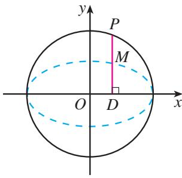

例 2 如图 3.1-5，在圆 $x^{2}+y^{2}=4$ 上任取一点 P，过点 P 作 x 轴的垂线段 PD，D 为垂足。当点 P 在圆上运动时，线段 PD 的中点 M 的轨迹是什么？为什么？（当点 P 经过圆与 x 轴的交点时，规定点 M 与点 P 重合。）

## 题目补充材料（来源原文）

  
图3.1-5

## 相关知识点

- [椭圆的定义与标准方程（范围关联）](../%E7%9F%A5%E8%AF%86%E7%82%B9/%E6%A4%AD%E5%9C%86%E7%9A%84%E5%AE%9A%E4%B9%89%E4%B8%8E%E6%A0%87%E5%87%86%E6%96%B9%E7%A8%8B.md)

> 来源：高中选择性必修 第一册·人教A版数学
