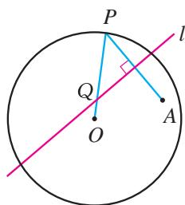

7. 彗星 “紫金山一号” 是南京紫金山天文台发现的，它的运行轨道是以太阳为一个焦点的椭圆。测得轨道的近日点（距离太阳最近的点）距太阳中心 1.486 天文单位，远日点（距离太阳最远的点）距太阳中心 5.563 天文单位（1 天文单位是太阳到地球的平均距离，约 $1.5 \times 10^{8}$ km），且近日点、

  
(第6题)

远日点及太阳中心在同一条直线上，求轨道的方程.

## 相关知识点

暂无已审核的相关知识点。

> 来源：高中选择性必修 第一册·人教A版数学
