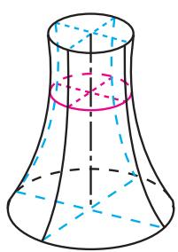
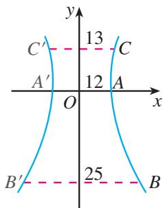
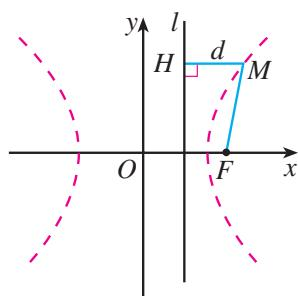
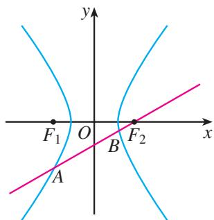

3. 对称轴都在坐标轴上的等轴双曲线的一个焦点是 $F_{1}(-6,0)$ ，求双曲线的标准方程和渐近线方程。4. 双曲线的渐近线方程是 $v = +2x$ ，虚轴长为 4，求双曲线的标准方程。

$$
y = \pm 2 x
$$

例 4 双曲线型冷却塔的外形，是双曲线的一部分绕其虚轴旋转所成的曲面（图 3.2-10（1））。它的最小半径为 12 m，上口半径为 13 m，下口半径为 25 m，高为 55 m。试建立适当的坐标系，求出此双曲线的方程（精确到 1 m）。

  
(1)

  
图3.2-10  
(2)

解：根据双曲线的对称性，在冷却塔的轴截面所在平面建立如图3.2-10（2）所示的直角坐标系 $Oxy$ ，使小圆的直径 $AA'$ 在 $x$ 轴上，圆心与原点重合。这时，上、下口的直
124 第三章 圆锥曲线的方程

径 $CC'$ ， $BB'$ 都平行于 x 轴，且 $\left|CC'\right|=13\times2,\left|BB'\right|=25\times2.$

设双曲线的方程为 $\frac{x^{2}}{a^{2}}-\frac{y^{2}}{b^{2}}=1\quad(a>0,\quad b>0)$ ，点C的坐标为 $(13,\quad y)$ ，则点B的坐标为 $(25,\quad y-55)$ .

因为直径 $AA'$ 是实轴，所以 a=12。又 B，C 两点都在双曲线上，所以

$$
\left(\frac {2 5 ^ {2}}{1 2 ^ {2}} - \frac {(y - 5 5) ^ {2}}{b ^ {2}} = 1, \right.\tag{①}
$$

$$
\left\lfloor \frac {1 3 ^ {2}}{1 2 ^ {2}} - \frac {y ^ {2}}{b ^ {2}} = 1. \right.\tag{②}
$$

由方程②，得 $y = \frac{5b}{12}$ （负值舍去）。代入方程①，得

$$
\frac {2 5 ^ {2}}{1 2 ^ {2}} - \frac {\left(\frac {5 b}{1 2} - 5 5\right) ^ {2}}{b ^ {2}} = 1.
$$

化简得

$$
1 9 b ^ {2} + 2 7 5 b - 1 8 1 5 0 = 0.\tag{③}
$$

解方程③，得

$$
b \approx 2 5 (\text {负值舍去}).
$$

因此所求双曲线的方程为

$$
\frac {x ^ {2}}{1 4 4} - \frac {y ^ {2}}{6 2 5} = 1.
$$

例 5 动点 $M(x, y)$ 与定点 $F(4, 0)$ 的距离和它到定直线 $l: x = \frac{9}{4}$ 的距离的比是常数 $\frac{4}{3}$ ，求动点 M 的轨迹.

解：设 $d$ 是点 $M$ 到直线 $l$ 的距离，根据题意，动点 $M$ 的轨迹就是点的集合

$$
P = \left\{M \left| \frac {| M F |}{d} = \frac {4}{3} \right. \right\},
$$

由此得

$$
\frac {\sqrt {(x - 4) ^ {2} + y ^ {2}}}{\left| x - \frac {9}{4} \right|} = \frac {4}{3}.
$$

将上式两边平方，并化简，得

$$
7 x ^ {2} - 9 y ^ {2} = 6 3,
$$

即

$$
\frac {x ^ {2}}{9} - \frac {y ^ {2}}{7} = 1.
$$

图3.2-11

所以，点 M 的轨迹是焦点在 x 轴上，实轴长为 6、虚轴长为 $2\sqrt{7}$ 的双曲线（图 3.2-11）.

思考

将例 5 与椭圆一节中的例 6 比较，你有什么发现？

例6 如图3.2-12，过双曲线 $\frac{x^2}{3} -\frac{y^2}{6} = 1$ 的右焦点 $F_{2}$ 倾斜角为 $30^{\circ}$ 的直线交双曲线于 $A$ ， $B$ 两点，求 $|AB|$

解：由双曲线的标准方程可知，双曲线的焦点分别为 $F_{1}(-3,0)$ ， $F_{2}(3,0)$ .

因为直线 AB 的倾斜角是 $30^{\circ}$ ，且经过右焦点 $F_{2}$ ，所以直线 AB 的方程为

  
图3.2-12

$$
y = \frac {\sqrt {3}}{3} (x - 3).\tag{①}
$$

由 $\left\{\begin{aligned}y&=\frac{\sqrt{3}}{3}(x-3),\\ \frac{x^{2}}{3}-\frac{y^{2}}{6}&=1\end{aligned}\right.$ 消去 y，得

$$
5 x ^ {2} + 6 x - 2 7 = 0.
$$

解方程，得

$$
x _ {1} = - 3, x _ {2} = \frac {9}{5}.
$$

将 $x_{1}$ ， $x_{2}$ 的值分别代入①，得

$$
y _ {1} = - 2 \sqrt {3}, y _ {2} = - \frac {2 \sqrt {3}}{5}.
$$

于是， $A$ ， $B$ 两点的坐标分别为（ $-3$ ， $-2\sqrt{3}$ ）， $\left(\frac{9}{5}, - \frac{2\sqrt{3}}{5}\right)$

所以

$$
\begin{array}{r l} \mid A B \mid & = \sqrt {(x _ {1} - x _ {2}) ^ {2} + (y _ {1} - y _ {2}) ^ {2}} \\ & = \sqrt {\left(- 3 - \frac {9}{5}\right) ^ {2} + \left(- 2 \sqrt {3} + \frac {2 \sqrt {3}}{5}\right) ^ {2}} \\ & = \frac {1 6 \sqrt {3}}{5}. \end{array}
$$

## 相关知识点

- [双曲线的对称性（范围关联）](../%E7%9F%A5%E8%AF%86%E7%82%B9/%E5%8F%8C%E6%9B%B2%E7%BA%BF%E7%9A%84%E5%AF%B9%E7%A7%B0%E6%80%A7.md)
- [双曲线的离心率（范围关联）](../%E7%9F%A5%E8%AF%86%E7%82%B9/%E5%8F%8C%E6%9B%B2%E7%BA%BF%E7%9A%84%E7%A6%BB%E5%BF%83%E7%8E%87.md)
- [双曲线的顶点与实虚轴（范围关联）](../%E7%9F%A5%E8%AF%86%E7%82%B9/%E5%8F%8C%E6%9B%B2%E7%BA%BF%E7%9A%84%E9%A1%B6%E7%82%B9%E4%B8%8E%E5%AE%9E%E8%99%9A%E8%BD%B4.md)
- [双曲线的范围（范围关联）](../%E7%9F%A5%E8%AF%86%E7%82%B9/%E5%8F%8C%E6%9B%B2%E7%BA%BF%E7%9A%84%E8%8C%83%E5%9B%B4.md)
- [双曲线的渐近线（范围关联）](../%E7%9F%A5%E8%AF%86%E7%82%B9/%E5%8F%8C%E6%9B%B2%E7%BA%BF%E7%9A%84%E6%B8%90%E8%BF%91%E7%BA%BF.md)

> 来源：高中选择性必修 第一册·人教A版数学
