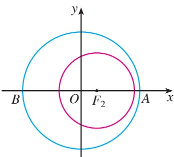

1. 如图，我国发射的第一颗人造地球卫星的运行轨道，是以地心（地球的中心） $F_{2}$ 为一个焦点的椭圆。已知它的近地点（离地面最近的点）A距地面439 km，远地点（离地面最远的点）B距地面2384 km，并且 $F_{2}$ ，A，B在同一直线上，地球半径约为6371 km。求：（1）卫星运行的轨道方程（精确到1 km）；（2）卫星轨道的离心率。

  
(第1题)

## 相关知识点

暂无已审核的相关知识点。

> 来源：高中选择性必修 第一册·人教A版数学
