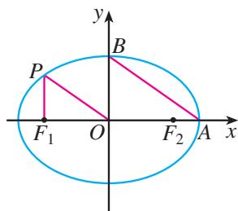

8. 如图，从椭圆 $\frac{x^2}{a^2} + \frac{y^2}{b^2} = 1 (a > b > 0)$ 上一点 $P$ 向 $x$ 轴作垂线，垂足恰为左焦点 $F_1$ 。又点 $A$ 是椭圆与 $x$ 轴正半轴的交点，点 $B$ 是椭圆与 $y$ 轴正半轴的交点，且 $AB // OP$ ， $|F_1 A| = \sqrt{10} + \sqrt{5}$ ，求椭圆的方程。

## 相关知识点

暂无已审核的相关知识点。

> 来源：高中选择性必修 第一册·人教A版数学
